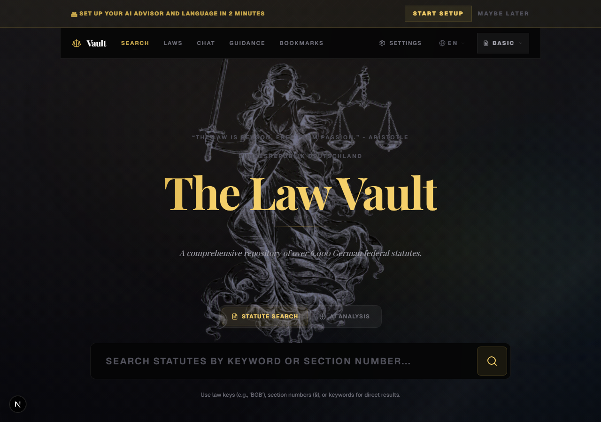
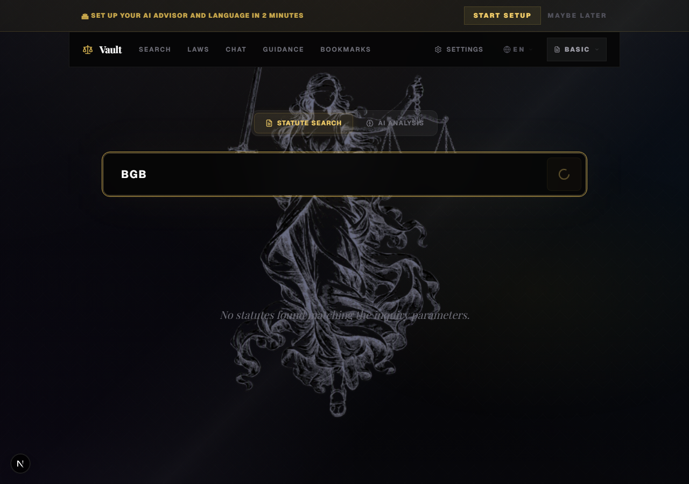
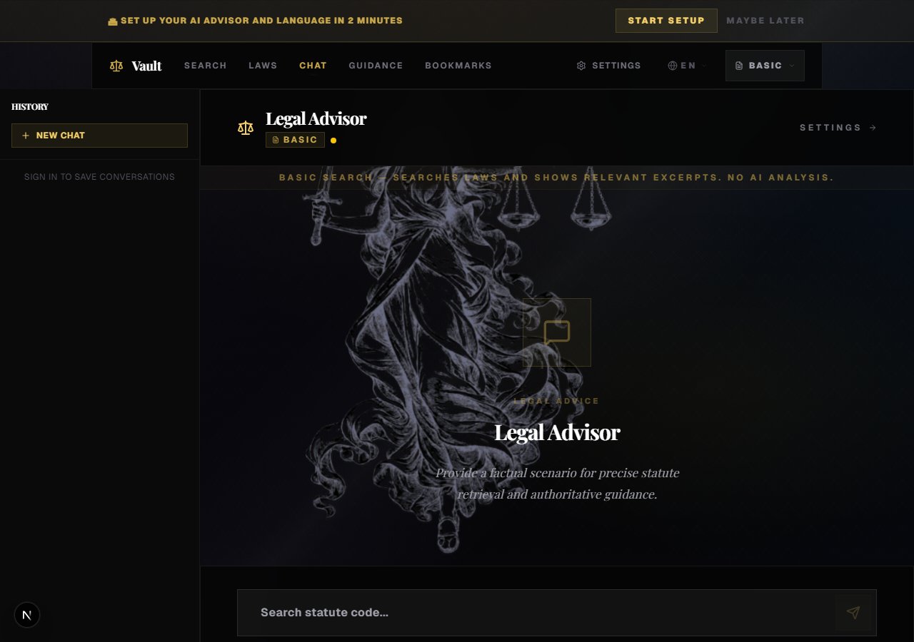
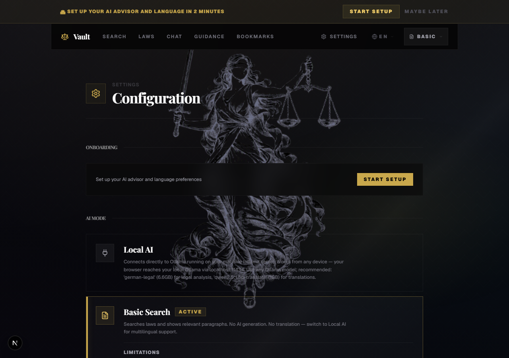
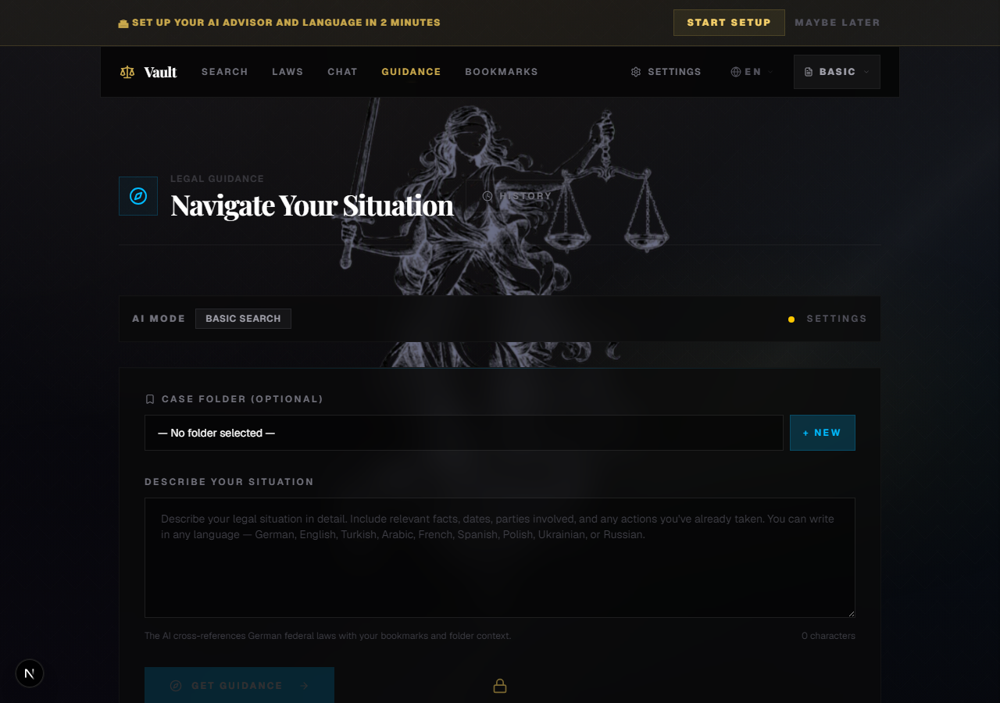
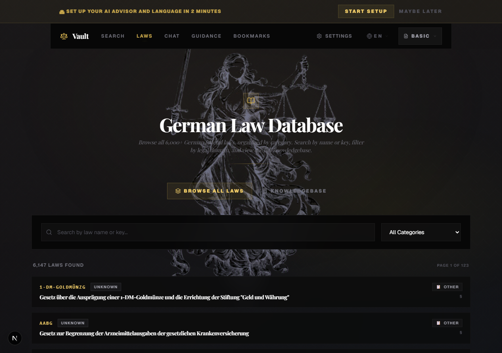

# Germa ⚖️ — A German Law Vault. Local Edition

**6,000+ German Federal Laws — AI-Guided Legal Analysis & Semantic Search (100% Local)**

German Law Vault provides a comprehensive search engine and AI-guided legal assistant for all German federal laws from [gesetze-im-internet.de](https://www.gesetze-im-internet.de/). Everything runs on your machine — no cloud services, no API keys, no data leaves your computer.

## Screenshots

| Homepage                                    | Search Results                                          | AI Chat                             |
| ------------------------------------------- | ------------------------------------------------------- | ----------------------------------- |
|      |  |  |
| **Settings**                                | **Guidance**                                            | **Laws**                            |
|  |              |  |

## Features

- 🔍 **Hybrid Search** — FTS5 (BM25 trigram) + Ollama embeddings across 6,000+ federal laws
- 📚 **Know Your Rights Guides** — curated articles for common situations (police, tenancy, employment, consumer, traffic)
- 🤖 **AI Chat** — ask legal questions, get answers with citations (powered by Ollama)
- 📊 **AI Guidance Engine** — describe your situation, get 3-5 outcome paths with risk/cost estimates
- 📝 **German Legal Document Templates** — Widerspruch, Mahnung, Kündigung, Einspruch, Klage
- 🌐 **9-Language UI** — DE/EN/TR/AR/FR/ES/PL/UK/RU
- 🔒 **100% Local** — Ollama + SQLite, no cloud dependencies, no credentials

## Quick Start

### Prerequisites

- Node.js 18+
- Python 3.10+
- llama.cpp CUDA

### Setup

```bash
# 1. Clone
git clone https://github.com/shahriarhaqueabir/Germa.git
cd German-Law-Vault

# 2. Install Node dependencies
cd nextjs && npm install

# 3. Pull local models
A main model for conversation and assistance
B secondary model for embedding

# 4. Configure
cp .env.example .env.local
# Edit .env.local with your Ollama URL and model names

# 5. Download and ingest German laws (one-time, ~20 min)
cd .. && python scripts/download_de_laws.py
python scripts/process_de_laws.py
python scripts/migrate_to_app_db.py
python scripts/rebuild_fts_trigram.py

# 6. Seed rights guides
python scripts/seed_rights_guides.py --db data/german-law.db --dir data/rights-guides

# 7. (Optional) Run embedding ingest (one-time, ~6 hours)
python scripts/ingest_embeddings.py

# 8. Start
cd nextjs && npm run dev  # → http://localhost:3000
```

### LLM Setup

The app auto-detects available models. Recommended:

- **Chat/Guidance**: Any 7B+ model (Qwythos 9B, Llama 3, Mistral, etc.)
- **Embeddings**: `nomic-embed-text` (required for semantic search)
- **Translation**: Any 1.5B+ model (Qwen 1.5B, Phi-3 Mini, etc.)

If your models are in a non-default directory:

```bash
# Windows
[System.Environment]::SetEnvironmentVariable("OLLAMA_MODELS", "E:\path\to\models", "User")
# Then restart
```

## Tech Stack

| Layer     | Technology                                             |
| --------- | ------------------------------------------------------ |
| Framework | Next.js 16 (App Router)                                |
| UI        | React 19, Tailwind CSS 4                               |
| Language  | TypeScript (strict)                                    |
| Database  | SQLite (better-sqlite3)                                |
| Search    | FTS5 (BM25 trigram) + Ollama nomic-embed-text (vector) |
| AI        | Ollama (chat, embeddings, translation)                 |
| Testing   | Vitest 4.1+                                            |

## Commands

```bash
cd nextjs
npm run dev              # Start dev server → http://localhost:3000
npx vitest run           # Run all tests (233 passing)
npx tsc --noEmit         # Type check (0 errors)
npm run lint             # ESLint
```

## What Works ✅

- **Search** — FTS5 trigram search finds German compound words ("Miete" matches "Mieterhöhung", "Mietvertrag", etc.). 6,147 laws, 107,864 norms indexed.
- **AI Chat** — RAG pipeline retrieves relevant norms, Ollama answers with citations
- **Translation** — Translate German legal text to 9 languages via Ollama (cached)
- **AI Guidance** — Describe your situation, get 3-5 outcome paths with risk/cost analysis
- **Document Templates** — Generate filled German legal documents (Widerspruch, Mahnung, etc.)
- **Know Your Rights Guides** — 5 curated guides (police, rent, employment, consumer, traffic)
- **Bookmarks & Folders** — Save laws to case folders with 8 uniform properties
- **9-Language UI** — Full i18n support
- **Auto-detect models** — App queries llama.cpp and picks best model per role
- **System Status** — Shows DB stats, embedding progress, Ollama health

## Architecture

```
┌──────────────────────────────────────────────────┐
│  Browser (http://localhost:3000)                 │
│  Next.js App Router (React 19, Tailwind 4)       │
└──────────────┬───────────────────────────────────┘
               │  /api/* (localhost, no CORS issues)
┌──────────────▼───────────────────────────────────┐
│  Next.js server process (Node)                   │
│  ┌────────────────┐   ┌──────────────────────┐   │
│  │  SQLite        │   │  Ollama client       │   │
│  │  (better-      │   │  /api/chat           │   │
│  │   sqlite3)     │   │  /api/embed          │   │
│  │  FTS5 trigram  │   │  /api/tags           │   │
│  └────────┬───────┘   └──────────┬───────────┘   │
│           │                       │              │
│  ┌────────┴───────┐   ┌──────────▼───────────┐   │
│  │ data/german-   │   │  Ollama daemon       │   │
│  │ law.db         │   │  (localhost:11434)    │   │
│  │ (single file)  │   │  Chat + Embed +      │   │
│  └────────────────┘   │  Translate models     │   │
│                       └──────────────────────┘   │
└──────────────────────────────────────────────────┘
```

- **No cloud services** — everything runs on your machine
- **No auth** — single user, no login required
- **No credentials** — no API keys, no encryption, no secrets

## Project Structure

```
German-Law-Vault/
├── nextjs/                 # Next.js app
│   ├── src/
│   │   ├── app/           # Pages and API routes
│   │   ├── components/    # React components
│   │   ├── lib/           # Core logic (db, search, ollama, types)
│   │   └── hooks/         # React hooks
│   ├── .env.example       # Environment template
│   └── package.json
├── scripts/               # Python data pipeline
│   ├── download_de_laws.py # Download laws from gesetze-im-internet.de
│   ├── process_de_laws.py # Parse XML → SQLite (laws.db)
│   ├── migrate_to_app_db.py # Migrate laws.db → data/german-law.db
│   ├── rebuild_fts_trigram.py # Build FTS5 trigram index
│   ├── seed_rights_guides.py # Seed rights guides into DB
│   └── ingest_embeddings.py # Embed norms with Ollama (long-running)
├── data/
│   ├── german-law.db      # SQLite database (single file)
│   └── rights-guides/     # Curated markdown guides
├── docs/
│   ├── superpowers/       # Design specs and plans
│   └── decisions/         # Architecture decision records
└── archive/               # Archived cloud-era code (Supabase)
```

## Data Pipeline

```
download_de_laws.py → de_federal_raw/ (6,147 XML files)
    ↓
process_de_laws.py → laws.db (6,147 laws, 107,864 norms)
    ↓
migrate_to_app_db.py → data/german-law.db (app schema)
    ↓
rebuild_fts_trigram.py → FTS5 trigram index
    ↓
seed_rights_guides.py → rights_guides table
    ↓
ingest_embeddings.py → norm_embeddings table (hours, resumable)
```

## License

Apache License 2.0 — See [LICENSE](LICENSE) for details.

---

<div align="center">
  <sub>Built with ❤️ for accessible German legal information</sub><br>
  <sub>⚖️ <em>Sub lege libertas</em> — Under the law, freedom</sub>
</div>
