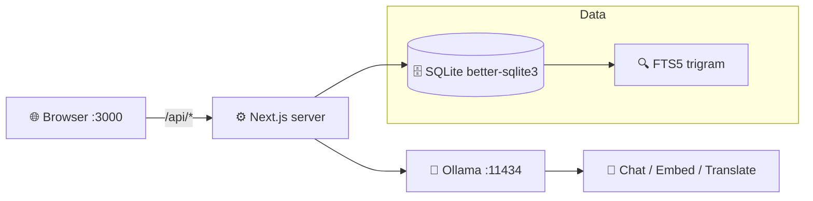

# Klarecht - German Law Vault (Local Edition)

<p align="center">
  
</p>
> **6,000+ German Federal Laws — AI-Guided Legal Analysis & Semantic Search,
> 100% Local.** Everything runs on your machine: no cloud, no API keys, no data
> leaves your computer. 🛡️

[](https://github.com/shahriarhaqueabir/german-law-vault/actions/workflows/ci.yml)
[](https://nextjs.org)
[](https://www.typescriptlang.org)
[](LICENSE)
[](#testing)

---

## Fun things you can do

- Search 6,000+ German federal laws in plain language - no legal degree required
- Ask "what are my rights as a tenant?" and get an answer with citations
- Find the weirdest, most obscure laws still on the books

## 🎬 The story — why this exists

German federal law is public, but searching it is painful: the official portal
is slow, legal language is dense, and most "legal tech" tools send your
situation to a cloud. German Law Vault puts 6,000+ federal laws on your machine
with hybrid search (FTS5 + vector embeddings) and an AI assistant that answers
with citations — all via Ollama. No credentials, no cloud, no data leaves. ⚖️

> 💡 **The one sentence that drove everything:** _Legal information should be
> searchable, citable, and private._

---

## 🔁 The feedback loop (zero → finished)

```
  1. 📥 INGEST    download + parse 6,000+ XML laws (one-time, ~20 min)
  2. 🗄️  MIGRATE   laws.db → app DB (SQLite)
  3. 🔍 INDEX     FTS5 trigram index + (optional) vector embeddings
  4. 🌱 SEED      rights guides into the DB
  5. 🔎 SEARCH    hybrid FTS5 (BM25) + Ollama vector search
  6. 🤖 CHAT      RAG pipeline → answer with citations
  7. 📊 GUIDANCE  describe situation → 3-5 outcome paths with risk/cost
  8. 🔁 REPEAT    resumable embedding ingest, cached translations
```

> 🧠 **Secret of the loop:** embeddings are resumable and the FTS index works
> even before embeddings finish. You get useful search on day one.

---

## 🏗️ Architecture — how the pieces talk



| Component     | Responsibility                       | Key location          |
| ------------- | ------------------------------------ | --------------------- |
| 🌐 Frontend   | Pages, i18n (9 langs), search UI     | `nextjs/src/app/`     |
| ⚙️ API routes | Search, chat, guidance, templates    | `nextjs/src/app/api/` |
| 🗄️ Database   | SQLite single file, FTS5, embeddings | `data/german-law.db`  |
| 🤖 AI         | Ollama chat/embed/translate          | `localhost:11434`     |
| 🐍 Pipeline   | Download/parse/migrate/index/seed    | `scripts/`            |

---

## 🏆 Good choices (and why they were good)

1. **🔍 Hybrid search.** FTS5 trigram handles German compound words
   ("Miete" → "Mieterhöhung", "Mietvertrag"); vector search adds semantic
   recall. Both degrade gracefully.
2. **🤖 Auto-detect models.** App queries Ollama and picks the best model per
   role (chat, embed, translate). No manual config.
3. **📦 Single-file SQLite.** Portable, backup-friendly, no server to manage.
4. **🔒 No credentials.** No API keys, no auth, no secrets. Single user.
5. **🌍 9-language UI.** DE/EN/TR/AR/FR/ES/PL/UK/RU with cached translation.
6. **📄 Document templates.** Generate filled German legal documents
   (Widerspruch, Mahnung, Kündigung, Einspruch, Klage).

---

## 📋 The playbook — recreate from zero

### Phase 0 — Scope 🎯

1. One sentence: _"Legal information should be searchable, citable, private."_
2. Boundaries: 100% local, no cloud, no credentials.

### Phase 1 — Skeleton 🦴

3. Next.js 16 (App Router) + TypeScript strict + Tailwind 4.
4. SQLite via better-sqlite3.

### Phase 2 — Data pipeline 🐍

5. Download 6,147 XML laws from gesetze-im-internet.de.
6. Parse XML → SQLite (`laws.db`).
7. Migrate to app schema (`data/german-law.db`).
8. Rebuild FTS5 trigram index.
9. Seed rights guides.
10. (Optional, ~6h) Embed norms with Ollama (resumable).

### Phase 3 — Search 🔍

11. FTS5 BM25 trigram search.
12. Vector search via nomic-embed-text.
13. Hybrid ranking + result highlighting.

### Phase 4 — AI features 🤖

14. RAG chat with citations.
15. AI guidance engine (situation → outcome paths with risk/cost).
16. Translation with caching.
17. Document template generation.

### Phase 5 — Polish 🎨

18. 9-language i18n.
19. Bookmarks & case folders.
20. System status dashboard.

### Phase 6 — Ship 🚢

21. `npm run dev` → `http://localhost:3000`.
22. `npx vitest run` → 233 tests.

---

## ⚠️ Mistakes to avoid

- 🚫 **Blocking on embeddings.** FTS works immediately; embeddings improve
  recall over time. Don't gate search on full ingest.
- 🚫 **Assuming Ollama is up.** Graceful degradation when daemon is down.
- 🚫 **German stemming assumptions.** Trigram handles substrings, not
  morphology. Consider query expansion.
- 🚫 **Stale settings layout.** Cloud-era leftovers linger; audit after
  migration.

---

## 🧰 Stack

| Layer        | Technology                           | Why                   |
| ------------ | ------------------------------------ | --------------------- |
| 🌐 Framework | Next.js 16 (App Router)              | SSR + API routes      |
| ⚛️ UI        | React 19, Tailwind CSS 4             | Modern, fast          |
| 📝 Language  | TypeScript (strict)                  | Type safety           |
| 🗄️ Database  | SQLite (better-sqlite3)              | Single file, portable |
| 🔍 Search    | FTS5 (BM25 trigram) + Ollama vectors | Hybrid recall         |
| 🤖 AI        | Ollama (chat, embed, translate)      | 100% local            |
| 🧪 Tests     | Vitest 4.1+                          | Fast, TS-native       |

## 🚀 Quick start

```bash
# 1. Clone
git clone https://github.com/<your-username>/German-Law-Vault.git
cd German-Law-Vault

# 2. Install
cd nextjs && npm install

# 3. Pull Ollama models
ollama pull nomic-embed-text:latest
ollama pull qwen2.5:1.5b-translate

# 4. Configure
cp .env.example .env.local

# 5. Download + ingest laws (one-time, ~20 min)
cd .. && python scripts/download_de_laws.py
python scripts/process_de_laws.py
python scripts/migrate_to_app_db.py
python scripts/rebuild_fts_trigram.py
python scripts/seed_rights_guides.py --db data/german-law.db --dir data/rights-guides

# 6. (Optional) Embed norms (~6 hours, resumable)
python scripts/ingest_embeddings.py

# 7. Start
cd nextjs && npm run dev   # → http://localhost:3000
```

## 📟 Commands

```bash
cd nextjs
npm run dev              # dev server → http://localhost:3000
npx vitest run           # all tests (233 passing)
npx tsc --noEmit         # type check (0 errors)
npm run lint             # ESLint
```

## 📊 What works ✅

- 🔍 **Search** — FTS5 trigram finds German compound words. 6,147 laws,
  107,864 norms indexed.
- 🤖 **AI Chat** — RAG pipeline with citations.
- 🌐 **Translation** — 9 languages via Ollama (cached).
- 📊 **AI Guidance** — situation → 3-5 outcome paths with risk/cost.
- 📝 **Document Templates** — Widerspruch, Mahnung, Kündigung, Einspruch,
  Klage.
- 📚 **Know Your Rights Guides** — 5 curated guides.
- 🔖 **Bookmarks & Folders** — case organization.
- 🌐 **9-Language UI** — full i18n.
- 🤖 **Auto-detect models** — best model per role.
- 📈 **System Status** — DB stats, embedding progress, Ollama health.

## 🔧 What needs work

- **High:** embedding ingest (26,750 / 107,864 done), German stemming,
  rights-guide legal accuracy, settings polish, onboarding wizard.
- **Medium:** more rights guides, model management UI, error handling,
  progress indicators.
- **Low:** auto-pull models, export/backup, dark/light theme, keyboard
  shortcuts.

## 📁 Project structure

```
German-Law-Vault/
├── nextjs/                 # Next.js app
│   ├── src/app/            # Pages + API routes
│   ├── src/components/     # React components
│   ├── src/lib/            # Core logic (db, search, ollama, types)
│   └── src/hooks/          # React hooks
├── scripts/                # Python data pipeline
├── data/                   # SQLite DB + rights guides
├── docs/                   # Specs and ADRs
└── archive/                # Archived cloud-era code (Supabase)
```

## 📸 Screenshots

| View 1 | View 2 | View 3 |
|---|---|---|
|  |  |  |

> Add your own screenshots under docs/screenshots/.

## 📌 TL;DR

- **Problem:** slow, cloud-based German legal search with no privacy.
- **Solution:** Next.js 16 + SQLite + Ollama: 6,000+ laws, hybrid FTS5+vector, 9-language UI.
- **Why it is interesting:** shows how to build a fully local RAG app over a real public dataset.


## 📜 License

Apache License 2.0 — see [LICENSE](LICENSE).

---

<div align="center">
  <sub>Built with ❤️ for accessible German legal information</sub><br>
  <sub>⚖️ <em>Sub lege libertas</em> — Under the law, freedom</sub>
</div>
